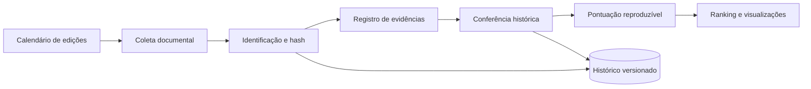

<div align="center">

# IGFB
### ÍNDICE DE GRANDEZA DO FUTEBOL BRASILEIRO

**História, desempenho e consistência. Um índice construído para ser questionado — e reproduzido.**

[](https://www.python.org/)
[](https://github.com/samuelbarrosmacedo/igfb/actions/workflows/igfb-research.yml)
[](#andamento)
[](#andamento)

**[METODOLOGIA](#metodologia)** · **[CRITÉRIOS](#matriz-de-pontuação)** · **[PIPELINE](#pipeline-de-dados)** · **[ANDAMENTO](#andamento)**

---

### O que significa ser grande?

O IGFB estuda a trajetória dos clubes brasileiros a partir de **conquistas, campanhas, permanência na elite e desempenho ao longo do tempo**. Seu propósito não é substituir o debate: é estabelecer uma base quantitativa transparente para ele.

</div>

## Visão geral

O índice combina desempenho esportivo e continuidade histórica. Cada registro que influenciar a classificação deverá identificar **clube, competição, edição, resultado, evidência e regra de pontuação**. O sistema diferencia informações coletadas de resultados efetivamente homologados.

| Pilar | O que mede |
|:--|:--|
| **Conquistas** | Títulos nacionais e internacionais, com pesos por relevância |
| **Campanhas** | Vice-campeonatos e colocações relevantes |
| **Regularidade** | Participações na Série A desde 1971 |
| **Desempenho histórico** | Consistência em diferentes períodos |
| **Rebaixamentos** | Quedas esportivas confirmadas entre divisões |

> [!IMPORTANT]
> **O ranking definitivo ainda não foi publicado.** O indicador histórico de aproximadamente **38%** é uma estimativa preliminar, **não auditada**. Não representa cobertura comprovada nem resultados homologados.

## Metodologia

**Recorte principal:** temporadas encerradas até **2025**. O Campeonato Brasileiro Série A é considerado **a partir de 1971**. Taça Brasil, Robertão e a competição de 1937 **não pontuam** neste modelo.

**1987:** a atribuição do título brasileiro ao Flamengo é uma **convenção expressa do IGFB**, sem alegação de consenso institucional. O tratamento da edição deve impedir duplicidades e permanecer identificado no registro de origem.

**Rebaixamentos:** só são contabilizadas quedas esportivas comprovadas. Mudanças administrativas, formatos excepcionais e resultados revertidos exigem análise documental antes de qualquer penalidade.

### Matriz de pontuação

Pesos **experimentais**, sujeitos à calibração e à análise de sensibilidade:

| Indicador | Título | Vice | Outros resultados |
|:--|--:|--:|:--|
| Mundial clássico | +900 | — | — |
| Mundial FIFA anual | +950 | — | — |
| Mundial expandido | +1.100 | — | — |
| Libertadores | +700 | +250 | Semifinal +90 |
| Campeonato Brasileiro | +450 | +160 | 3º +75 · 4º +45 |
| Copa do Brasil | +300 | +110 | Semifinal +40 |
| Copa Sul-Americana | +200 | +70 | — |
| CONMEBOL / Mercosul | +170 | +60 | — |
| Recopa | +100 | +30 | — |
| Supercopa | +75 | +20 | — |
| Campeonato estadual | +25 | +8 | — |
| Permanência na Série A | — | — | +8 por temporada |
| Rebaixamento A → B | — | — | −400 |
| Rebaixamento B → C | — | — | −600 |
| Rebaixamento C → D | — | — | −800 |

A aplicação de pesos pressupõe registros verificados. **Uma página coletada não equivale a um resultado confirmado.**

## Núcleo matemático (em desenvolvimento)

A implementação em [`igfb_agent/scoring.py`](igfb_agent/scoring.py) calcula pesos experimentais exclusivamente sobre registros aprovados, elimina duplicações do mesmo resultado, evita somar bônus de semifinal ao título/vice da mesma edição e disponibiliza três transformações estatísticas independentes:

- **Consistência temporal (índice de Jain):** `C = (Σpₜ)² / (T·Σpₜ²)`, com pontuações anuais não negativas e anos sem resultado representados por zero.
- **Padronização por temporada:** `Z = (p − μₜ) / σₜ`, com retorno zero para variância nula.
- **Transformação logística estável:** `I(z) = 100 / (1 + exp(−z))`, para representar um índice calibrado entre 0 e 100.

Esses componentes **não formam ainda o índice definitivo**. Falta definir o universo de comparação, tratar assimetrias históricas, calibrar coeficientes e testar robustez, incerteza e sensibilidade dos pesos. Não há pontuação de clubes homologada nesta fase. Os testes estão em [`tests/test_scoring.py`](tests/test_scoring.py).

### Identidade das edições

Os registros de pontuação aceitam um identificador opcional `edition_id` para distinguir torneios diferentes realizados no mesmo ano. Registros legados continuam válidos com a identidade provisória `competição:ano`. **Para homologação histórica, edições potencialmente ambíguas exigem identificação explícita** (por exemplo, competição, federação e temporada). O identificador não é evidência documental por si só; deve ser vinculado às fontes de cada resultado.

### Auditoria de conflitos e sensibilidade

O módulo [`igfb_agent/audit.py`](igfb_agent/audit.py) verifica colocações incompatíveis dentro de uma edição e sinaliza múltiplos campeões da mesma competição. Semifinal é tratada como etapa alcançada, não como colocação incompatível com título ou vice; a pontuação utiliza apenas o melhor resultado da edição. Ele **não resolve automaticamente disputas históricas**; essas ocorrências exigem análise documental e convenções explícitas. A detecção é conservadora: não substitui regras específicas de formatos excepcionais.

O mesmo módulo calcula um **envelope de sensibilidade** para conjuntos explícitos de pesos:

```math
S_c^{\min}=\min_{\theta\in\Theta}S_c(\theta),\qquad S_c^{\max}=\max_{\theta\in\Theta}S_c(\theta)
```

O envelope mostra a variação do resultado sob cenários metodológicos e **não é intervalo de confiança estatístico**. Testes específicos ficam em [`tests/test_audit.py`](tests/test_audit.py). Nenhum ranking foi gerado com dados fictícios.

> [!CAUTION]
> **Limite do esquema atual:** resultados estaduais ainda precisam identificar a federação e a edição específica. O auditor não considera campeões de estados diferentes um conflito global. Da mesma forma, categorias históricas com mais de um torneio por temporada exigem identificadores próprios antes de uma homologação completa.

### Integridade referencial e robustez de posições

O módulo [`registry.py`](igfb_agent/registry.py) introduz catálogos explícitos de edições e evidências, com validação de ano, organizador, jurisdição estadual, hash SHA-256 e integridade referencial. A função `score_verified` é a entrada recomendada para pontuar resultados homologados; registros legados sem edição explícita não passam nessa validação.

O módulo [`robustness.py`](igfb_agent/robustness.py) calcula ranking com empates, extremos de pontuação, melhor/pior posição e estabilidade entre cenários explícitos de pesos. **Fração de cenários na primeira posição não representa probabilidade estatística**.

O [protocolo de auditoria](docs/PROTOCOLO_AUDITORIA.md) estabelece estados de evidência, chaves canônicas, invariantes históricas e requisitos para publicar classificações. Os novos testes estão em [`tests/test_registry_robustness.py`](tests/test_registry_robustness.py).

### Medição objetiva de cobertura

O módulo [`coverage.py`](igfb_agent/coverage.py) mede quantas edições **cadastradas** possuem registros e quantas possuem ao menos um resultado aprovado, separando registros pendentes de aprovados. Seu denominador é o catálogo disponível, **não todas as edições históricas existentes**. Portanto, essa taxa não deve ser apresentada como progresso global do IGFB.

Testes de cobertura e integridade: [`tests/test_coverage.py`](tests/test_coverage.py). A estimativa antiga de 38% continua não auditada.

### Calendário de temporadas e relatório de cobertura

O módulo [`calendar.py`](igfb_agent/calendar.py) gera **55 identidades de edições do Brasileiro de 1971 a 2025**, além de identidades separadas para a participação anual na Série A. Não inclui Taça Brasil, Robertão ou 1937. O calendário **não contém campeões, participantes, colocações nem resultados homologados**. Os metadados de organização precisam ser verificados por edição.

Para gerar um relatório JSON reproduzível da cobertura inicial do calendário:

```bash
python -m igfb_agent.baseline_report
```

Esse relatório registra 55 edições cadastradas e zero resultados aprovados, sem converter essa contagem em porcentagem de conclusão do projeto. Os testes de regressão ficam em [`tests/test_calendar.py`](tests/test_calendar.py).

### Primeiras pistas históricas documentadas

O arquivo [`historical_source_leads.json`](config/historical_source_leads.json) registra referências institucionais da CBF para resultados de 1971, 1972, 1973, 1975, 1976, 1981, 1987, 1993, 1994, 1996, 2016, 2018 e 2021. **São afirmações de fontes, não registros homologados**, e 1987 requer atenção especial à evolução institucional e jurídica da controvérsia.

A rotina [`candidates.py`](igfb_agent/candidates.py) gera candidatos explícitos com `approved: false` e `candidate_requires_review`, sem pontuar clubes:

```bash
python -m igfb_agent.candidates
```

A conferência ainda deve examinar o documento original, verificar integridade/hash, identidade do clube e decisões de homologação. Os testes ficam em [`tests/test_candidates.py`](tests/test_candidates.py).

### Auditoria das pistas e testes contínuos

[`source_readiness.py`](igfb_agent/source_readiness.py) calcula a distribuição das pistas por ano e clube, além das temporadas ainda sem nenhuma pista. Esses números **não representam resultados homologados** nem cobertura histórica integral. A base institucional foi ampliada com referências a 2022, 2023, 2025 e títulos do Corinthians na era de pontos corridos. A fonte de participações do Flamengo de 2026 contém contagem desde 1967: **essa contagem não deve ser importada** para o IGFB, que começa em 1971.

O workflow [`igfb-ci.yml`](.github/workflows/igfb-ci.yml) roda compilação, testes unitários e comandos de relatório em push e pull request, sem chamadas a APIs pagas, coleta automática ou escrita de resultados. **A criação do workflow não equivale à confirmação de execução bem-sucedida**; verificar o status na aba Actions.

## Pipeline de dados



A coleta experimental pode ser acionada manualmente; não há execução periódica ativa. O processamento conserva registros entre execuções. Fontes já coletadas não são baixadas novamente sem necessidade; falhas entram em espera para nova tentativa. A coleta utiliza [HTTPX](https://www.python-httpx.org/) e [Beautiful Soup](https://www.crummy.com/software/BeautifulSoup/bs4/doc/); o agendamento e o histórico ficam no [GitHub Actions](https://docs.github.com/actions) e no Git.

> [!NOTE]
> A implementação atual cobre a **etapa inicial de coleta e rastreabilidade**. Conferência histórica abrangente, pontuação integral e publicação do ranking ainda dependem de desenvolvimento e auditoria.

## Andamento

| Frente | Situação |
|:--|:--|
| Definição do recorte e pesos | Documentada; calibração pendente |
| Coleta incremental | Implementada em caráter inicial |
| Registro de eventos | Implementado |
| Calendário do Brasileiro 1971–2025 | 55 edições canônicas geradas; metadados e resultados pendentes de verificação |
| Revisão cruzada de resultados | Protocolo definido; dados ainda pendentes |
| Rebaixamentos e formatos especiais | Pendente |
| Núcleo matemático e testes unitários | Pontuação, catálogos e cenários implementados; calibração e auditoria pendentes |
| Visualização final | Pendente |

Consulte [o estado do projeto](state/status.json), [o histórico de coleta](state/events.jsonl) e [as execuções](https://github.com/samuelbarrosmacedo/igfb/actions/workflows/igfb-research.yml).

## Organização

```text
config/                 recorte, convenções e fontes
igfb_agent/             rotina de coleta incremental
state/                  eventos e checkpoints
.github/workflows/      execução agendada
requirements.txt        dependências Python
```

## Executar

Requer Python 3.12 ou superior.

```bash
python -m venv .venv
source .venv/bin/activate
python -m pip install -r requirements.txt
python -m igfb_agent
```

No Windows PowerShell, a ativação do ambiente é `.venv\Scripts\Activate.ps1`. A execução experimental é manual pelo GitHub Actions. A revisão matemática e documental ocorre por etapas, com mudanças versionadas.

## Política de evidências

A pesquisa prioriza registros institucionais da **CBF, CONMEBOL, FIFA e federações**, complementados por acervos históricos e fontes secundárias identificadas. Divergências são registradas e investigadas; não são resolvidas por mera preferência de uma fonte. Conteúdos externos permanecem sujeitos a direitos autorais e às condições de acesso de seus respectivos sites.

## Licenciamento

**Licença ainda não definida.** A publicação deste repositório não implica autorização automática de redistribuição ou uso comercial.

---

<div align="center">

### IGFB

**A grandeza se debate. Os números precisam resistir à análise.**

<sub>Pesquisa histórica · Metodologia aberta à revisão · Resultados sujeitos a auditoria</sub>

</div>
