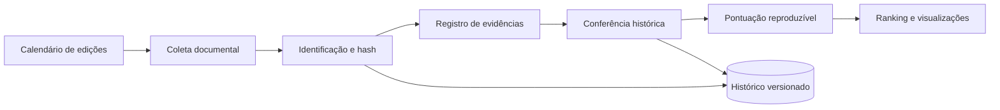

<div align="center">

# IGFB
### ÍNDICE DE GRANDEZA DO FUTEBOL BRASILEIRO

**História, desempenho e consistência. Um índice construído para ser questionado — e reproduzido.**

[](https://www.python.org/)
[](https://github.com/samuelbarrosmacedo/igfb/actions/workflows/igfb-research.yml)
[](#andamento)
[](#andamento)

**[METODOLOGIA](#metodologia)** · **[CRITÉRIOS](#matriz-de-pontuação)** · **[PIPELINE](#pipeline-de-dados)** · **[ANDAMENTO](#andamento)**

---

### O que significa ser grande?

O IGFB estuda a trajetória dos clubes brasileiros a partir de **conquistas, campanhas, permanência na elite e desempenho ao longo do tempo**. Seu propósito não é substituir o debate: é estabelecer uma base quantitativa transparente para ele.

</div>

## Visão geral

O índice combina desempenho esportivo e continuidade histórica. Cada registro que influenciar a classificação deverá identificar **clube, competição, edição, resultado, evidência e regra de pontuação**. O sistema diferencia informações coletadas de resultados efetivamente homologados.

| Pilar | O que mede |
|:--|:--|
| **Conquistas** | Títulos nacionais e internacionais, com pesos por relevância |
| **Campanhas** | Vice-campeonatos e colocações relevantes |
| **Regularidade** | Participações na Série A desde 1971 |
| **Desempenho histórico** | Consistência em diferentes períodos |
| **Rebaixamentos** | Quedas esportivas confirmadas entre divisões |

> [!IMPORTANT]
> **O ranking definitivo ainda não foi publicado.** O indicador histórico de aproximadamente **38%** é uma estimativa preliminar, **não auditada**. Não representa cobertura comprovada nem resultados homologados.

## Metodologia

**Recorte principal:** temporadas encerradas até **2025**. O Campeonato Brasileiro Série A é considerado **a partir de 1971**. Taça Brasil, Robertão e a competição de 1937 **não pontuam** neste modelo.

**1987:** a atribuição do título brasileiro ao Flamengo é uma **convenção expressa do IGFB**, sem alegação de consenso institucional. O tratamento da edição deve impedir duplicidades e permanecer identificado no registro de origem.

**Rebaixamentos:** só são contabilizadas quedas esportivas comprovadas. Mudanças administrativas, formatos excepcionais e resultados revertidos exigem análise documental antes de qualquer penalidade.

### Matriz de pontuação

Pesos **experimentais**, sujeitos à calibração e à análise de sensibilidade:

| Indicador | Título | Vice | Outros resultados |
|:--|--:|--:|:--|
| Mundial clássico | +900 | — | — |
| Mundial FIFA anual | +950 | — | — |
| Mundial expandido | +1.100 | — | — |
| Libertadores | +700 | +250 | Semifinal +90 |
| Campeonato Brasileiro | +450 | +160 | 3º +75 · 4º +45 |
| Copa do Brasil | +300 | +110 | Semifinal +40 |
| Copa Sul-Americana | +200 | +70 | — |
| CONMEBOL / Mercosul | +170 | +60 | — |
| Recopa | +100 | +30 | — |
| Supercopa | +75 | +20 | — |
| Campeonato estadual | +25 | +8 | — |
| Permanência na Série A | — | — | +8 por temporada |
| Rebaixamento A → B | — | — | −400 |
| Rebaixamento B → C | — | — | −600 |
| Rebaixamento C → D | — | — | −800 |

A aplicação de pesos pressupõe registros verificados. **Uma página coletada não equivale a um resultado confirmado.**

## Pipeline de dados



O processamento é incremental e conserva registros entre execuções. Fontes já coletadas não são baixadas novamente sem necessidade; falhas entram em espera para nova tentativa. A coleta utiliza [HTTPX](https://www.python-httpx.org/) e [Beautiful Soup](https://www.crummy.com/software/BeautifulSoup/bs4/doc/); o agendamento e o histórico ficam no [GitHub Actions](https://docs.github.com/actions) e no Git.

> [!NOTE]
> A implementação atual cobre a **etapa inicial de coleta e rastreabilidade**. Conferência histórica abrangente, pontuação integral e publicação do ranking ainda dependem de desenvolvimento e auditoria.

## Andamento

| Frente | Situação |
|:--|:--|
| Definição do recorte e pesos | Documentada; calibração pendente |
| Coleta incremental | Implementada em caráter inicial |
| Registro de eventos | Implementado |
| Calendário do Brasileiro 1971–2025 | Integrado à fila de coleta |
| Revisão cruzada de resultados | Pendente |
| Rebaixamentos e formatos especiais | Pendente |
| Cálculo integral e testes históricos | Pendente |
| Visualização final | Pendente |

Consulte [o estado do projeto](state/status.json), [o histórico de coleta](state/events.jsonl) e [as execuções](https://github.com/samuelbarrosmacedo/igfb/actions/workflows/igfb-research.yml).

## Organização

```text
config/                 recorte, convenções e fontes
igfb_agent/             rotina de coleta incremental
state/                  eventos e checkpoints
.github/workflows/      execução agendada
requirements.txt        dependências Python
```

## Executar

Requer Python 3.12 ou superior.

```bash
python -m venv .venv
source .venv/bin/activate
python -m pip install -r requirements.txt
python -m igfb_agent
```

No Windows PowerShell, a ativação do ambiente é `.venv\Scripts\Activate.ps1`. O processamento agendado ocorre no GitHub Actions, sujeito à disponibilidade e aos limites do serviço.

## Política de evidências

A pesquisa prioriza registros institucionais da **CBF, CONMEBOL, FIFA e federações**, complementados por acervos históricos e fontes secundárias identificadas. Divergências são registradas e investigadas; não são resolvidas por mera preferência de uma fonte. Conteúdos externos permanecem sujeitos a direitos autorais e às condições de acesso de seus respectivos sites.

## Licenciamento

**Licença ainda não definida.** A publicação deste repositório não implica autorização automática de redistribuição ou uso comercial.

---

<div align="center">

### IGFB

**A grandeza se debate. Os números precisam resistir à análise.**

<sub>Pesquisa histórica · Metodologia aberta à revisão · Resultados sujeitos a auditoria</sub>

</div>
