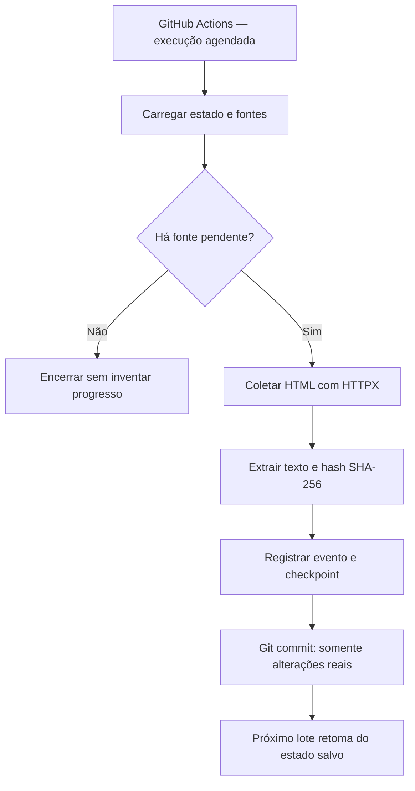

<div align="center">

# IGFB
### Índice de Grandeza do Futebol Brasileiro

**Um ranking histórico do futebol brasileiro construído com evidências, regras explícitas e cálculos reproduzíveis.**

[](https://www.python.org/)
[](https://github.com/samuelbarrosmacedo/igfb/actions)
[](#licença-e-uso)
[](#estado-atual)

**[Acompanhar execuções](https://github.com/samuelbarrosmacedo/igfb/actions)** · **[Consultar metodologia](#metodologia)** · **[Ver estado do projeto](state/status.json)** · **[Examinar código](igfb_agent/)**

</div>

---

> [!IMPORTANT]
> **Transparência:** este repositório está em desenvolvimento. **Não existe ranking final auditado.** A referência histórica de **38% é uma estimativa anterior, ainda não verificada**, e não deve ser interpretada como cobertura de dados ou percentual de testes aprovados.

## A pergunta que queremos responder

**Quais são os maiores clubes da história do futebol brasileiro — e como justificar cada posição?**

O IGFB transforma critérios esportivos em um modelo de pontuação inspecionável. Cada resultado precisa estar associado à sua edição, competição, fonte, regra de interpretação e cálculo. O objetivo não é produzir uma lista com aparência de precisão: é permitir que outra pessoa **reproduza, conteste e audite** o ranking.

### Princípios

| Princípio | Compromisso |
|:--|:--|
| **Rastreabilidade** | Toda afirmação pontuável deve ter origem verificável |
| **Reprodutibilidade** | Pesos e fórmulas são aplicados por código, não por opinião da IA |
| **Separação de estados** | Encontrado ≠ extraído ≠ validado ≠ pontuado |
| **Tratamento de controvérsias** | Convenções metodológicas são declaradas, nunca disfarçadas de consenso |
| **Continuidade** | Execuções independentes preservam checkpoints e evitam repetir trabalho |
| **Custo adicional zero** | A automação deve respeitar as cotas gratuitas dos serviços utilizados |

## Metodologia

### Recorte histórico

- O **Campeonato Brasileiro Série A** começa em **1971** para fins de títulos, campanhas e longevidade do IGFB.
- **Taça Brasil (1959–1968), Robertão (1967–1970) e torneio de 1937** ficam excluídos de pontuação e bônus.
- **Flamengo em 1987:** tratado como campeão por **convenção metodológica do IGFB**, explicitamente distinta de reconhecimento oficial consensual; a edição não pode gerar campeão ou vice duplicado.
- Temporadas em curso não são misturadas com séries históricas já encerradas. O corte inicial de consolidação é **2025**.
- Rebaixamentos devem ser esportivos, confirmados e associados à transição de divisão; formatos excepcionais exigem análise específica.

### Pesos experimentais

Os valores abaixo são **hipóteses de modelagem**, não resultado final calibrado.

| Competição / indicador | Campeão | Vice | Outros |
|:--|--:|--:|:--|
| Mundial clássico | +900 | — | |
| Mundial FIFA anual | +950 | — | |
| Mundial expandido | +1.100 | — | |
| Libertadores | +700 | +250 | Semifinal +90 |
| Brasileirão Série A | +450 | +160 | 3º +75; 4º +45 |
| Copa do Brasil | +300 | +110 | Semifinal +40 |
| Sul-Americana | +200 | +70 | |
| CONMEBOL / Mercosul | +170 | +60 | |
| Recopa | +100 | +30 | |
| Supercopa | +75 | +20 | |
| Estadual | +25 | +8 | |
| Longevidade Série A (1971+) | — | — | +8 por edição |
| Rebaixamento A → B | — | — | −400 |
| Rebaixamento B → C | — | — | −600 |
| Rebaixamento C → D | — | — | −800 |

> [!WARNING]
> A tabela documenta a **proposta de pesos**. A implementação atual ainda **não calcula o ranking completo**, nem valida todas as competições. Não confunda metodologia definida com processamento concluído.

## Como funciona a automação



**Implementado nesta fase:** coleta de páginas previamente cadastradas, registro de hashes, histórico de eventos e checkpoint em Git. **Planejado:** descoberta automática de fontes, extração estruturada por LLM, confronto de evidências, cálculos completos, revisão de controvérsias e dashboard final.

**IA gratuita não está conectada nesta versão.** A assinatura ChatGPT Plus não inclui chamadas gratuitas à API da OpenAI. Nenhuma chave privada deve ser incluída no repositório.

## Estado atual

| Componente | Situação |
|:--|:--|
| Repositório GitHub | Criado |
| Regras iniciais | Documentadas |
| Coleta HTTP | Implementação inicial |
| Histórico de eventos / deduplicação | Implementação inicial |
| Agendamento | Configurado no workflow; execução real precisa ser verificada |
| Descoberta ampla de fontes | Pendente |
| IA para interpretação histórica | Pendente |
| Validação cruzada | Pendente |
| Cálculo integral do ranking | Pendente |
| Dashboard final | Pendente |

O arquivo [`state/status.json`](state/status.json) registra o estado declarado do projeto. O arquivo [`state/events.jsonl`](state/events.jsonl) contém eventos produzidos pelas execuções, quando existirem.

## Estrutura do repositório

```text
igfb/
├── .github/workflows/igfb-research.yml  # GitHub Actions
├── config/
│   ├── project_rules.json                # Restrições metodológicas
│   └── seed_sources.json                 # Fontes iniciais
├── igfb_agent/
│   ├── __init__.py
│   └── __main__.py                        # Coleta experimental
├── state/
│   ├── events.jsonl                      # Registro de eventos
│   └── status.json                       # Estado resumido
├── requirements.txt
└── README.md
```

## Executar localmente

Requer Python 3.12+.

```bash
python -m venv .venv
source .venv/bin/activate
python -m pip install -r requirements.txt
IGFB_FETCH_LIMIT=2 python -m igfb_agent
```

No Windows PowerShell, ative com `.venv\Scripts\Activate.ps1` e defina a variável de ambiente com `$env:IGFB_FETCH_LIMIT="2"`.

Para execução na nuvem, acesse **[Actions](https://github.com/samuelbarrosmacedo/igfb/actions)**. A execução agendada usa a configuração do workflow e pode atrasar por limitações do GitHub.

## Critérios de qualidade antes de publicar um ranking

- [ ] Cobertura histórica de cada competição elegível
- [ ] Fontes rastreáveis por edição e clube
- [ ] Deduplicação de títulos, campanhas e temporadas
- [ ] Revisão de edições com regulamentos excepcionais
- [ ] Rebaixamentos confirmados e sem penalidades indevidas
- [ ] Pesos calibrados e análise de sensibilidade
- [ ] Testes de regressão e auditoria de dados
- [ ] Dashboard navegável, com explicação de cada pontuação

## Fontes e responsabilidade editorial

Prioridade para **CBF, CONMEBOL, FIFA, federações e registros históricos verificáveis**. Fontes secundárias podem orientar a descoberta, mas não substituem a avaliação da evidência. Conteúdos coletados de terceiros continuam sujeitos a direitos autorais e condições de acesso.

## Licença e uso

**Nenhuma licença de código aberto foi definida ainda.** O repositório ser público não concede automaticamente permissão para reutilização do código. Uma licença poderá ser adicionada após decisão do mantenedor.

---

<div align="center">

**IGFB · Grandeza se argumenta. Dados se verificam.**

<sub>Desenvolvimento incremental · Sem ranking final publicado · Transparência metodológica acima de aparência de certeza</sub>

</div>
